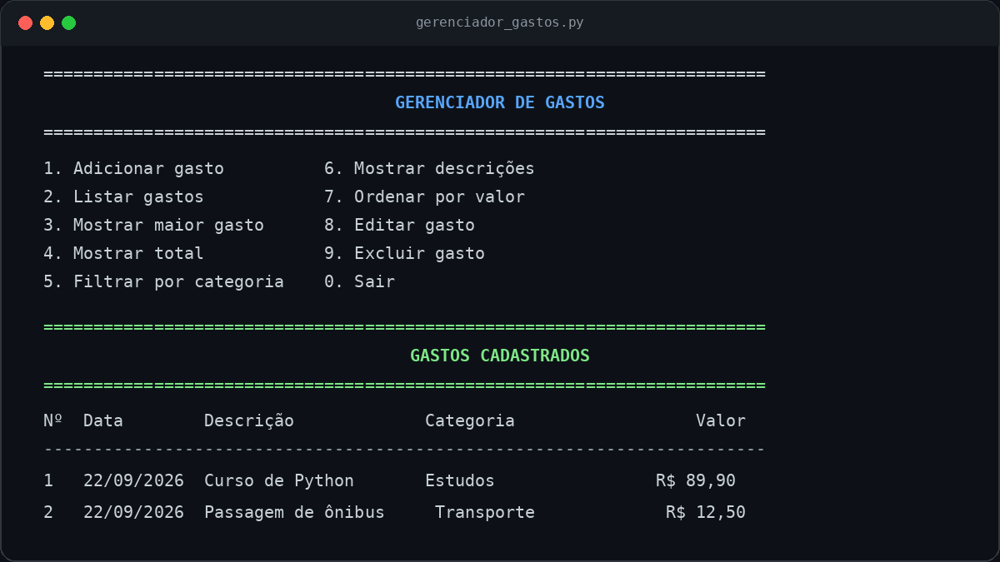

# Gerenciador de gastos em Python

Aplicação de terminal para registrar gastos pessoais e consultar onde o dinheiro foi usado. Permite cadastrar, listar, editar e excluir registros, filtrar por categoria e acompanhar o total acumulado.

Desenvolvido durante meus estudos de Python. O repositório mantém a primeira solução e uma versão refatorada, permitindo comparar a evolução do código.



## Funcionalidades

- Cadastro com descrição, valor, categoria e data.
- Listagem em tabela, maior gasto e total acumulado.
- Filtro por categoria e ordenação do maior para o menor valor.
- Edição de registros e exclusão com confirmação.
- Validação de descrição, opções do menu, valores e datas.
- Formatação brasileira de moeda, como `R$ 1.250,90`.

Os dados ficam em memória durante a execução e desaparecem ao encerrar o programa.

## Como executar

Requer Python 3 e Git para clonar. Usa somente a biblioteca padrão, sem dependências externas. Execução verificada com Python 3.12.14.

No Linux ou macOS:

```bash
git clone https://github.com/LuKeT-Dev-Py/gerenciador-de-gastos-python.git
cd gerenciador-de-gastos-python
python3 gerenciador_gastos.py
```

No Windows, use `py gerenciador_gastos.py` ou `python gerenciador_gastos.py` dentro da pasta do repositório.

Execute [gerenciador_gastos.py](gerenciador_gastos.py), a versão refatorada. [versao_original.py](versao_original.py) preserva a primeira solução para comparação.

## Experimente

1. Escolha `1` para adicionar um gasto.
2. Informe `Café`, valor `25,90`, categoria `1` (Alimento) e uma data válida, como `31/10/2026`.
3. Escolha `2` para listar ou `4` para consultar o total:

```text
Total acumulado: R$ 25,90
```

4. Use `8` para editar ou `9` para excluir o registro. Na edição, Enter mantém o valor atual; a exclusão exige confirmação com `s`.
5. Escolha `0` para sair.

As categorias disponíveis são Alimento, Lazer, Transporte e Estudos. No cadastro, deixar a data vazia usa o dia atual.

## Organização e conceitos

As funções de [gerenciador_gastos.py](gerenciador_gastos.py) separam entrada, validação, operações e exibição. O programa usa listas de dicionários, laços, condicionais, compreensão de listas, `lambda`, `max`, `sum`, `sorted` e `datetime`.

O bloco `if __name__ == '__main__'` permite importar as funções sem abrir o menu. O [registro de evolução](docs/evolucao.md) explica a refatoração e as decisões de validação e organização.

## Limitações e próximas melhorias

- Armazenamento somente em memória; salvar e carregar JSON é uma possível evolução.
- Ainda não há uma suíte de testes automatizados.
- Relatórios mensais e interface gráfica ou web são possibilidades futuras.

O exemplo de cadastro e total acima foi conferido por execução em Python 3.12.14.

## Licença

[MIT](LICENSE).
